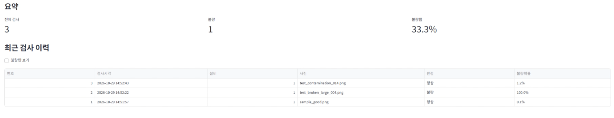
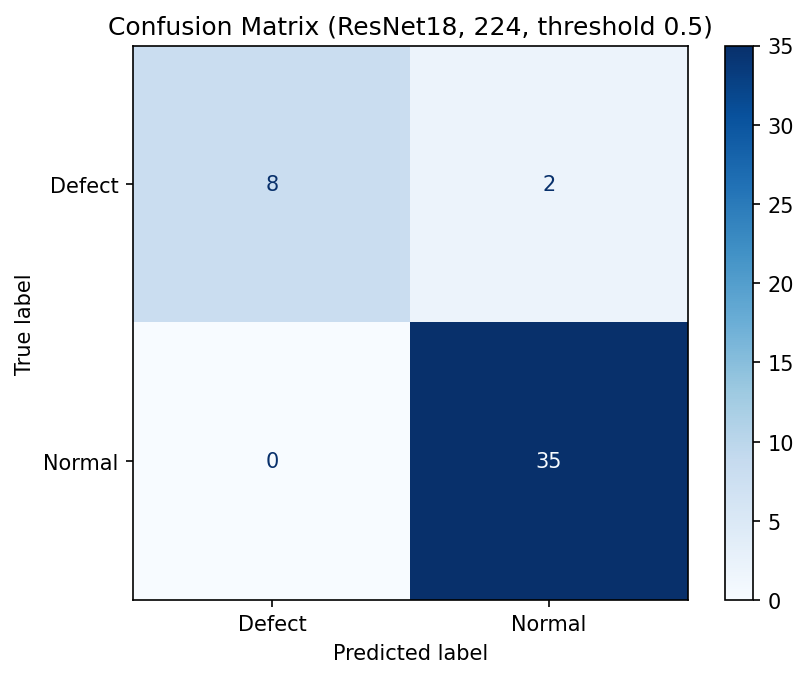
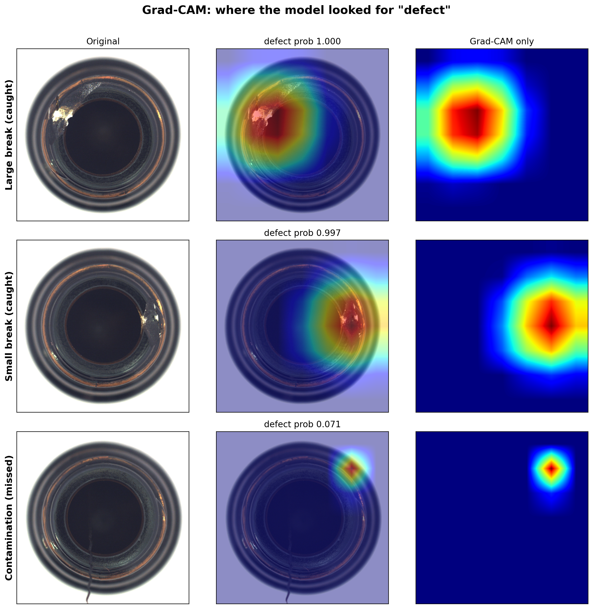

# factory-defect-detection

공장 외관 검사를 가정해, 병 입구 사진을 AI(ResNet18)가 정상/불량으로 판정하고 결과를 MariaDB에 저장해 Streamlit 대시보드로 보여주는 시스템입니다. 불량을 놓치지 않는 평가와 오분류 분석에 중점을 두었습니다.

## 핵심 결과
- 불량이 적어(정상 229 / 불량 63) 정확도 대신 **불량 재현율**로 평가: 테스트 불량 10장 중 9장 검출(0.900), 정상 오판 0
- 놓친 1장(오염 014)을 임계값, 해상도, 모델 비교, 5회 반복 학습으로 분석 → 임계값이나 학습 변동이 아니라 해당 사진의 난이도로 판단
- Grad-CAM으로 판정 근거를 시각화(대략적 영역, 위치 검출 아님)
- 한계: 공개 데이터셋 사용, 테스트 불량 10장으로 표본이 작음

## 시연 영상 / 화면
- 시연 영상: https://youtu.be/xRXbmAgvRpw
- 영상 구성: 정상 판정 → 큰 파손 판정(Grad-CAM) → 놓친 오염 사례(정상으로 판정) → 요약·이력



## 시스템 구조

```
[사진 업로드] → [model.py: ResNet18 판정] → [db.py: MariaDB 저장] → [app.py: Streamlit 대시보드]
                        └→ Grad-CAM (불량 판정 시 판정 근거 시각화)
```

| 파일 | 역할 |
|---|---|
| `model.py` | 사진 1장을 정상/불량과 불량확률로 판정, Grad-CAM 생성 |
| `db.py` | 판정 결과를 MariaDB에 저장·조회 (접속 정보는 `.env`로 분리) |
| `app.py` | 업로드, 판정, 요약(전체/불량/불량률), 이력 표, 히트맵을 보여주는 대시보드 |
| `docs/devlog.md` | 날짜별 개발 일지 |

- 학습은 Google Colab(T4 GPU), 실행은 WSL(Ubuntu, CPU)에서 했습니다.
- 사용 기술: Python, PyTorch(ResNet18 전이학습), scikit-learn, MariaDB, Streamlit

## 데이터와 분할

- MVTec AD (bottle 카테고리), 라이선스 CC BY-NC-SA 4.0 (비상업적 용도로 사용)
- 실제 설비 데이터를 구할 수 없어, 공개 산업 검사 데이터셋을 설비 카메라 이미지로 가정해 사용
- 정상 229장 / 불량 63장 (broken_large 20, broken_small 22, contamination 21), 정상이 약 3.6배 많은 불균형

| 구분 | 정상 | 불량 | 합계 |
|---|---|---|---|
| 학습 | 160 | 44 | 204 |
| 검증 | 34 | 9 | 43 |
| 테스트 | 35 | 10 | 45 |

- 정상/불량을 각각 7 : 1.5 : 1.5로 나눠(층화 분할) 세 구간의 비율을 유지했습니다.
- 모델은 검증셋으로 선택했고, 테스트셋은 성능 보고에 사용했습니다. 다만 임계값 탐색과 모델 비교 때 테스트셋 결과를 확인했기 때문에, 해당 부분은 아래에 한계로 명시했습니다.
- 불균형은 불량 틀림에 약 3.6배 큰 가중치(160/44)를 주어 보정했습니다.
- 파일명 충돌로 정상 12장이 덮어써지는 문제를 개수 검증으로 발견하고, 파일명에 상위 폴더명을 붙여 해결했습니다.

## 모델과 평가

- ResNet18(ImageNet 사전학습) 전이학습, 마지막 층을 2개(불량/정상)로 교체, 10 epoch, Adam(lr 1e-4)
- 불량이 적어 정확도만 보면 "전부 정상"으로 찍어도 높게 나오므로, **불량 재현율**을 핵심 지표로 삼았습니다.

| 지표 (테스트 45장, 임계값 0.5) | 값 |
|---|---|
| 정확도 | 0.978 (44/45) |
| 불량 재현율 | 0.900 (9/10) |
| 불량 정밀도 | 1.000 |
| 정상 오판 | 0 |



## 오분류 분석

테스트 불량 10장 중 1장(오염 014, 병 입구 안쪽의 가는 선형 이물질)을 정상으로 판정했습니다(불량확률 0.012).

| 시도 | 결과 |
|---|---|
| 임계값 조정 (0.9 ~ 0.01) | 0.01까지 내려야 검출되지만, 검증셋 정상 중 최대 확률(0.014)보다 낮아 정상 오판이 생김 → **채택하지 않음, 0.5 유지** (이 탐색에서 테스트셋 결과를 보았음) |
| 해상도 224 → 384 | 불량확률 0.012 → 0.200, 여전히 0.5 미달, 분리도 개선 없음 → 224 유지 |
| 모델 비교 (ResNet18 vs MobileNetV2) | 동일 분할·설정에서 재현율 모두 0.900, 놓친 사진은 둘 다 오염 유형 → ResNet18 유지 |
| 시드 5회 반복 | 5회 모두 재현율 0.90, 매번 같은 사진(오염 014)을 놓침 → 학습 변동이 아니라 해당 사진의 난이도로 판단 |

## 판정 근거 시각화 (Grad-CAM)
큰 파손·작은 파손은 결함 부위에 반응했고, 놓친 오염 014는 가는 선 부위에 반응이 거의 없었습니다. 히트맵은 판정 근거의 **대략적 시각화**이며 정확한 위치 검출이 아닙니다.



## 추가 실험: 카메라 재촬영 시험
모니터에 띄운 MVTec 사진(정상 1장, 큰 파손 1장)을 폰으로 재촬영해 대시보드에 올렸습니다.

| 사진 | 판정 | 불량확률 |
|---|---|---|
| 큰 파손 | 불량 | 100.0% |
| 정상 | 정상 | 6.5% (원본은 거의 0%) |

판정은 모두 맞았지만 정상의 불량확률이 올라, 촬영 환경 변화에 민감할 수 있음을 확인했습니다. (2장 시험이라 일반화할 수 없습니다.)

## 한계
- 공개 데이터셋을 사용했으며 실제 현장 데이터가 아닙니다.
- 테스트 불량이 10장이라 재현율 한 칸이 0.1입니다. 시드를 바꾼 반복은 같은 테스트 10장 기준이며, 분할이 바뀔 때의 변동은 측정하지 못했습니다.
- 임계값 탐색과 모델 비교 때 테스트셋 결과를 확인했습니다.
- 카메라 재촬영은 2장 시험입니다.
- 오염 014의 불량확률이 Colab(약 0.071)과 대시보드(0.012)에서 다르게 나왔고, 원인은 확정하지 못했습니다. 판정은 두 환경 모두 정상입니다.
- 수치는 정렬 고정 분할(재현 가능)로 다시 측정한 값입니다.
- 입력 파일 오류, DB 연결 실패, 모델 파일 누락에 대한 예외처리는 구현하지 않았으며, 후속 프로젝트에서 보강할 예정입니다.

## 실행 방법
1. 저장소를 받고 가상환경을 만든 뒤 `pip install -r requirements.txt`
2. 학습한 모델 `best_model.pth`(약 43MB)를 `models/` 폴더에 넣기 (용량 문제로 저장소에는 포함하지 않았으며, 요청 시 제공합니다)
3. MariaDB에 DB와 테이블 만들기

```sql
CREATE DATABASE factory CHARACTER SET utf8mb4;
USE factory;
CREATE TABLE inspections (
    id INT AUTO_INCREMENT PRIMARY KEY,
    inspected_at DATETIME NOT NULL DEFAULT CURRENT_TIMESTAMP,
    machine_id INT NOT NULL DEFAULT 1,
    image_name VARCHAR(255) NOT NULL,
    label VARCHAR(10) NOT NULL,
    defect_prob FLOAT NOT NULL
);
```

4. 프로젝트 폴더에 `.env` 파일을 만들어 DB 접속 정보 작성 (저장소에는 포함하지 않음)

```
DB_HOST=localhost
DB_USER=사용자이름
DB_PASSWORD=비밀번호
DB_NAME=factory
```

5. `streamlit run app.py`

## 향후 계획
- TCP 소켓 기반 설비 데이터 수집 서버를 별도 프로젝트로 개발하고, 본 시스템의 판정 결과를 전송하는 구조로 확장
- 직접 촬영한 데이터로 재학습, 실시간 카메라 연동

개발 일지: `docs/devlog.md`
